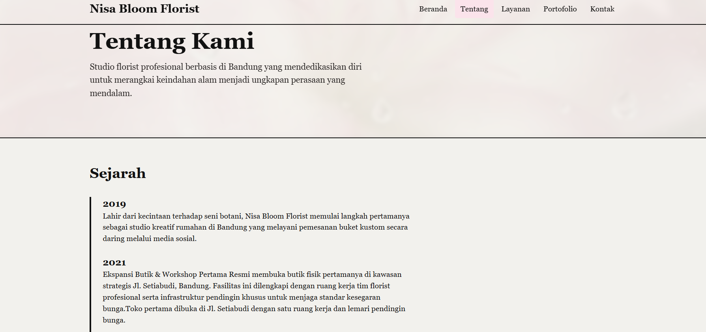
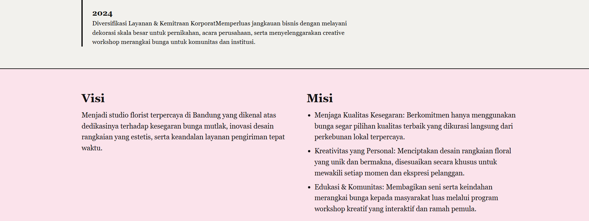
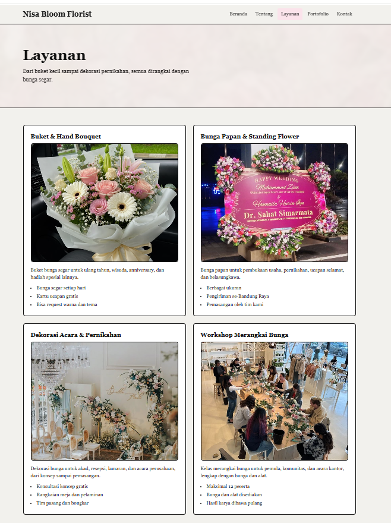
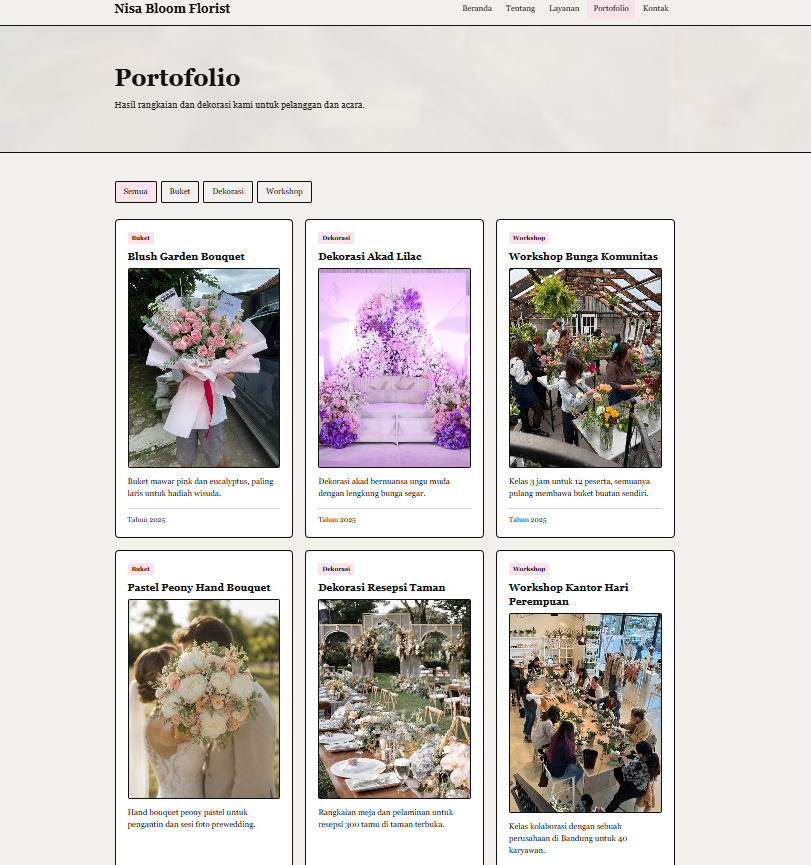
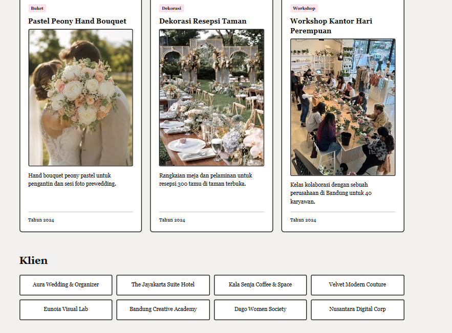
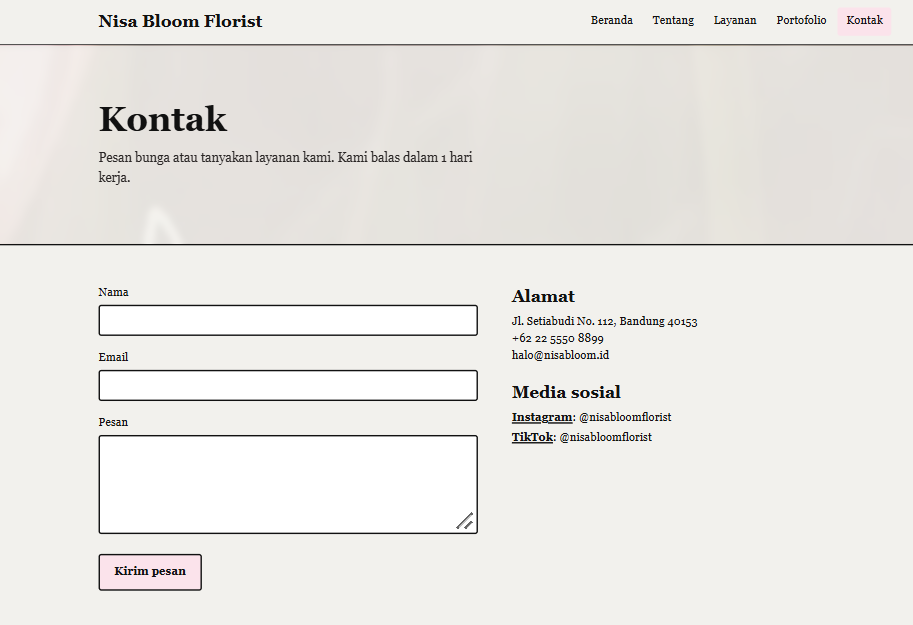

# Nisa Bloom Florist - Website Company Profile

**Nama:** (Nisa Agustin)
**NIM:** (2505580)
**Kelas:** (Pendidikan Ilmu Komputer C)

## Deskripsi
Nisa Bloom Florist adalah perusahaan studio bunga premium (premium florist & spatial design) terpercaya di Bandung yang berdiri sejak tahun 2019 dan berdedikasi untuk merangkai keindahan alam menjadi ungkapan perasaan yang mendalam. Sebagai korporasi kreatif, perusahaan ini melayani pembuatan buket kustom premium, bingkisan eksklusif (luxury hampers), serta penyediaan papan bunga ucapan formal untuk berbagai kebutuhan relasi bisnis institusi maupun acara personal.
 
## Cara Menjalankan

```bash
npm install
npm run dev
```

Buka alamat yang muncul di terminal (http://localhost:5173).

## Screenshot

### Beranda


### Tentang Kami




### Layanan


### Portofolio



### Kontak
